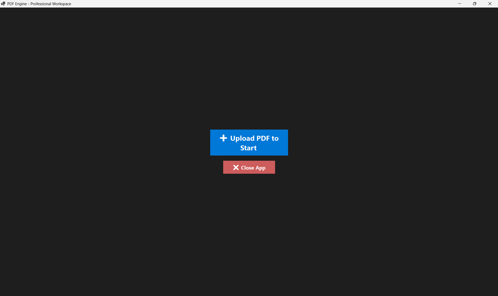
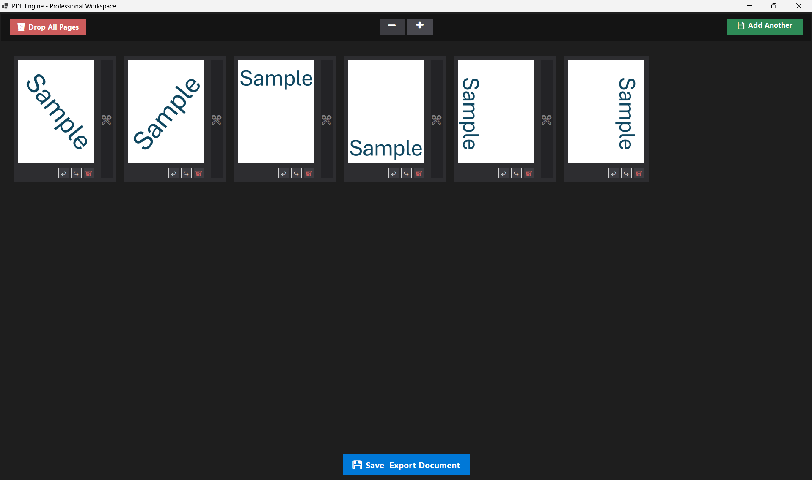

# 📄 PDF Engine


PDF Engine is a fast, desktop-native visual workspace for manipulating PDF documents. It allows you to visually merge, split, rotate, and reorder pages using a highly responsive drag-and-drop storyboard interface without permanently altering your original files until you are ready to export.



## ✨ Core Features

* **Visual Storyboard:** View your entire document as a grid of interactive cards.
* **Spatial Drag & Drop:** Seamlessly reorder pages across rows and columns.
* **The "Scissors" Tool:** Drop visual cut markers between pages to split a single document into multiple distinct PDF files in one click.
* **Instant Merging:** Append new PDFs to your current workspace instantly.
* **Per-Page Controls:** Rotate specific pages or delete them entirely from the final export.
* **Dynamic Zoom:** Scale the workspace in and out for a bird's-eye view of massive documents.



---

## 🏗️ How It Works: "Painter vs. Mechanic"

To ensure maximum performance and prevent UI freezing when handling massive PDF files, this application divides responsibilities into two distinct engines:

1. **The UI Renderer ("The Painter"):** Powered by `PdfiumViewer`. The app rapidly rasterizes "photographs" of each page for the UI. You are manipulating lightweight images in memory, allowing for lag-free Drag & Drop and instant visual rotations.
2. **The Core Logic ("The Mechanic"):** Powered by `PdfSharp`. The original PDF file is never altered during the session (Non-Destructive Editing). When you click **Save & Export**, the backend reads your visual layout, opens the original files asynchronously, and rapidly outputs the brand-new assembled PDFs.


---

## 🚀 Getting Started

You can run the application either by downloading the standalone executable (no installation required) or by building from source.

### Option 1: Quick Start (Standalone Executable - Recommended)

1. Head over to the **[Releases](https://github.com/Frisko2305/Engine_your_PDFs/releases)** tab.
2. Download `PDF_Engine.exe`.
3. Double-click the file to run it immediately — **no .NET installation or setup required**!

---

### Option 2: Build & Run from Source

#### Prerequisites
* [.NET 10.0 SDK](https://dotnet.microsoft.com/download/dotnet/10.0) or newer (Windows).

#### Clone & Run
Open PowerShell or your preferred terminal:
```bash
git clone https://github.com/Frisko2305/Engine_your_PDFs.git
cd Engine_your_PDFs/PDF_Engine.WinForms
dotnet run
```

Developed by Frisko2305.
